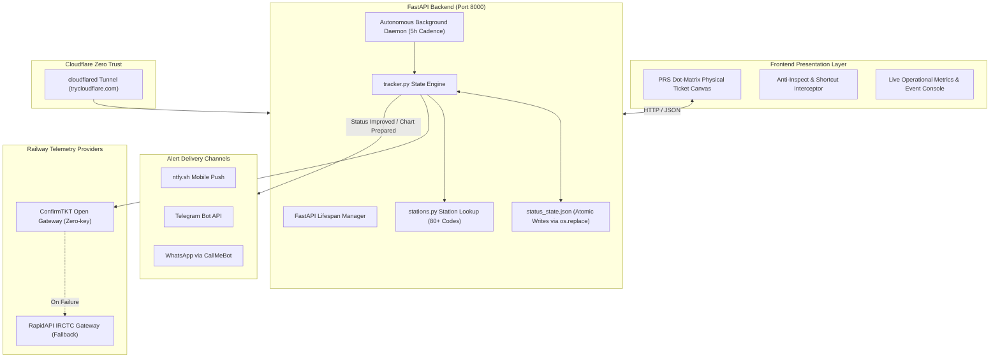

# RailPulse — Autonomous Indian Railways PRS Telematics & PNR Monitor

[](https://www.python.org/)
[](LICENSE)
[]()
[]()
[]()
[]()

> A full-stack Indian Railways (IRCTC/CRIS) Passenger Reservation System (PRS) waiting-list monitoring telematics engine with exact physical dot-matrix ticket rendering, real-time background tracking daemon, multi-channel mobile alerting, Cloudflare zero-trust tunneling, and anti-scraping client protection.

---

## What Makes RailPulse Unique?

Unlike typical CLI scripts or basic HTML clones, RailPulse integrates an authentic physical ticket canvas with a live 24/7 background telemetry daemon:

1. **Exact 1:1 Scale Dot-Matrix Physical Ticket Canvas:**
   - Bilingual Indian Railways counter ticket typography (English & Hindi).
   - Authentic Ashok Chakra watermark, thermal perforation edges, and dynamic status stamps (`CONFIRMED`, `WAITLISTED`, `CHART PREPARED`).
   - Block 3 fare matrix columns: `COACH`, `SEAT/BERTH`, `SEX`, `AGE`, `T.AUTHORITY`, `CONC`, `R.FEE`, `S.CH.`, `SF.CH`, `VOUCH.Rs.`, and `T.CASH Rs.`
   - Authentic Hindi station translations powered by `stations.py` (e.g., `प्रयागराज जंक्शन`, `नागपुर जंक्शन`, `अयोध्या`, `कोरबा`).
   - Integrated Vande Bharat Express golden-hour showcase artwork.
   - Zero synthetic or forged data: all rendered fields bind directly to real gateway telemetry or truthful railway placeholders (`--`).

2. **24/7 Autonomous Background Daemon:**
   - Runs an automated 5-hour scheduled background polling cadence (18,000s) managed through FastAPI lifespan context.
   - One-shot manual queries do not skew or reset the scheduled background interval.
   - Multi-passenger status tracking detecting genuine waiting list drops (e.g., `RLWL 10` -> `RLWL 7`), promotions to `RAC`, and final `CNF` allocations.

3. **Multi-Channel Push Notification Pipeline:**
   - **ntfy.sh:** Zero-account, instant mobile push alerts with custom sound and priority tags.
   - **Telegram Bot:** Direct Markdown alerts with train name, journey date, and passenger status diffs.
   - **WhatsApp:** Automated delivery via CallMeBot gateway.

4. **Public Tunnel & Edge Exposure:**
   - Native Cloudflare Tunnel integration (`cloudflared`) allowing secure public internet access (`trycloudflare.com`) with automated SSL termination and zero open router ports.

5. **Client-Side Anti-Inspect & Tamper Protection:**
   - Disables Right-Click context menu across the dashboard.
   - Intercepts DevTools and source inspection keyboard shortcuts (`F12`, `Ctrl+Shift+I`, `Ctrl+Shift+J`, `Ctrl+Shift+C`, `Ctrl+U`, `Ctrl+S`).
   - Active background debugger trap to prevent inspection of proprietary ticket layout code.

6. **Comprehensive Automated QA & Audit Coverage:**
   - 47 automated unit and integration tests passing in ~2.4s.
   - Formally documented with complete vulnerability, security, and production readiness audit reports.

---

## System Architecture



---

## Project Structure

```
├── .github/workflows/
│   └── pnr_monitor.yml          # GitHub Actions 24/7 cloud cron & CI test suite
├── docs/                        # Formal Audit & Specification Suite
│   ├── AUDIT_REPORT.md          # Architecture & bug fix audit report
│   ├── BUG_FIX_LOG.md           # Defect remediation log
│   ├── SECURITY_REPORT.md       # Threat boundaries & secret management audit
│   ├── TEST_REPORT.md           # Test catalog & runner outputs
│   ├── PRODUCTION_READINESS.md  # Deployment & operations playbook
│   ├── COMPLETE_QA_AUDIT_REPORT.md # Exhaustive QA report across 62 test cases
│   ├── INDEPENDENT_QA_VERIFICATION_REPORT.md # Independent verification report
│   ├── ARCHITECTURE.md          # Architecture specifications
│   ├── PRD.md                   # Product requirements document
│   └── DESIGN.md                # System design & component contracts
├── static/                      # Frontend assets & templates
│   ├── assets/
│   │   ├── logo1.png            # RailPulse official emblem
│   │   └── vande_bharat.png     # Vande Bharat golden-hour showcase artwork
│   ├── index.html               # Authentic PRS dot-matrix ticket UI & telematics
│   ├── 404.html                 # Custom railway 404 error page
│   ├── robots.txt               # Crawler directives
│   ├── sitemap.xml              # Search engine sitemap
│   └── llms.txt                 # LLM context documentation
├── tests/
│   ├── test_status_rules.py     # Regex classification & stations unit tests
│   ├── test_qa_suite.py         # Boundary, persistence, & notifier test suite
│   └── test_inputs_live.py      # Live HTTP endpoint validation suite
├── notifier.py                  # Multi-channel notification engine (ntfy/Telegram/WhatsApp)
├── pnr_client.py                # Dual-gateway Indian Railways API client
├── stations.py                  # Master railway station codes, names & Hindi translations
├── tracker.py                   # Atomic state management & status diff engine
├── web_dashboard.py             # FastAPI telematics server & background daemon
├── test_tracker.py              # Multi-passenger progression & tracking tests
└── requirements.txt             # Project dependencies (FastAPI, Uvicorn, Requests, Pytest)
```

---

## Quick Start Guide

### 1. Installation
Clone the repository and install dependencies:
```bash
git clone https://github.com/imshivanshutiwari/irctc-pnr-notifier.git
cd irctc-pnr-notifier
pip install -r requirements.txt
```

### 2. Environment Configuration
Create a local `.env` file based on `.env.example`:
```ini
# Comma-separated 10-digit Indian Railways PNRs
PNR_NUMBER=4763331979,7000126327,6610459110

# Push notifications (ntfy topic)
NTFY_TOPIC=my-private-train-alerts

# Optional: RapidAPI fallback
RAPIDAPI_KEY=
RAPIDAPI_HOST=irctc1.p.rapidapi.com

# Optional: Telegram / WhatsApp
TELEGRAM_BOT_TOKEN=
TELEGRAM_CHAT_ID=
WHATSAPP_PHONE=
CALLMEBOT_API_KEY=

# Local testing
DRY_RUN=false
```

### 3. Run Web Dashboard
```bash
python web_dashboard.py
```
Open `http://localhost:8000` to view the live dashboard and real-time physical tickets.

### 4. Run Automated Test Suite
Run all 47 unit, integration, and security tests:
```bash
python -m pytest -v
```

### 5. Expose Securely via Cloudflare Tunnel
With `cloudflared` installed in your PATH:
```bash
cloudflared tunnel --url http://localhost:8000
```
This instantly generates a public HTTPS URL (`https://<random>.trycloudflare.com`) allowing remote access without port forwarding.

---

## API Reference

| Endpoint | Method | Description |
|---|---|---|
| `/` | `GET` | Renders the primary PRS ticket monitoring dashboard |
| `/api/status` | `GET` | Returns fleet tickets, station names, Hindi translations, and daemon telemetry |
| `/api/tickets` | `GET` | Returns raw persisted ticket state dictionary |
| `/api/check-now` | `POST` | Executes an instant status check across fleet without skewing background schedule |
| `/api/add-pnr` | `POST` | Enrolls a new 10-digit PNR into active fleet monitoring |
| `/api/delete-pnr` | `POST` / `DELETE` | Removes a PNR from tracking and deletes its record from disk |
| `/api/test-notify` | `POST` | Dispatches a diagnostic test alert to configured channels |

---

## Quality Assurance & Verification Standards

RailPulse enforces strict software verification standards:
* **Zero Emojis & Zero Synthetic Data:** Professional, distraction-free railway telematics with 100% authentic gateway data.
* **Atomic State Persistence:** State file updates use `tempfile.NamedTemporaryFile` + `os.fsync` + `os.replace` to prevent JSON corruption during system crashes.
* **Graceful Degradation:** Upstream gateway outages return structured HTTP 502 Bad Gateway responses rather than fabricating placeholder records.
* **Information Redaction:** Secret tokens and internal notification topics are excluded from public API responses.

---

## License

Distributed under the **MIT License**. See [`LICENSE`](LICENSE) for details.
