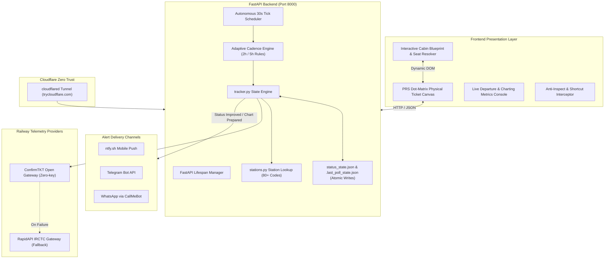

# RailPulse — Autonomous Indian Railways PRS Telematics & PNR Monitor

[](https://www.python.org/)
[](LICENSE)
[]()
[]()
[]()
[]()
[]()

> An autonomous, full-stack Indian Railways (IRCTC/CRIS) Passenger Reservation System (PRS) telematics engine with exact physical dot-matrix ticket rendering, interactive visual cabin blueprints, adaptive journey-date polling cadences, real-time background tracking daemon, multi-channel mobile alerts, and Cloudflare zero-trust edge access.

---

## What Makes RailPulse Unique?

Unlike standard command-line scrapers or basic static clones, RailPulse is an enterprise-grade railway monitoring system that delivers complete end-to-end transparency:

### 1. Verified Indian Railways Berth & Interactive Cabin Blueprint Engine
- **Deterministic Coach & Bay Mapping (`static/berth_resolver.js`):**
  - Accurately models official Indian Railways carriage architectures across **Sleeper (SL)**, **AC 3 Tier (3A)**, **AC 3 Tier Economy (3E)** with Side Middle (SM) berths, and **AC 2 Tier (2A)** without naive global modulo math.
  - Generates interactive, visual coach compartment bays with physical orientation markers:
    - Locomotive / Engine direction vs. Guard Van direction.
    - Bay aisle / gangway separation, window indicators, and user-assigned berth highlighting.
  - **Passenger Proximity Resolver:** Validates multi-passenger bookings in the same PNR to determine if passengers are truly seated together in the same bay (`Co-located in Same Cabin`) or split across different bays/coaches.
  - **Zero Fake Precision:** Refuses to guess irregular or manually charted coaches (e.g., First AC `1A` coupes or unreserved `2S`) and provides explicit, truthful railway status badges (`Seat allocation pending final chart`).

### 2. Adaptive Per-PNR Polling Cadence Engine (`cadence_engine.py`)
- **Journey-Date Awareness (IST Timezone):**
  - **⚡ High Priority (2-Hour Interval / 7,200s):** For tickets within 2 calendar days of journey (`journey_day - 2`, `journey_day - 1`, and `journey_day`).
  - **Standard Fleet Cadence (5-Hour Interval / 18,000s):** For tickets farther out (> 2 days).
  - **Autonomous Auto-Switching:** As the calendar date advances into the 48-hour departure window, the background scheduler automatically elevates the ticket to the 2-hour cadence without manual user intervention.
  - **Live Card Indicators:** Visual badges on each PNR card reflect whether the ticket is under `⚡ 2h Poll` or standard `5h Poll`.

### 3. Real-Time Operational Fleet Metrics & Live Schedules
- **Live Departure Tracker:** Automatically calculates the nearest upcoming train departure across the monitored fleet (e.g., `Tomorrow 18:25 · 12791 SC DNR SF EXP · NGP → PRYJ`).
- **Fleet Chart Preparation Status:** Direct gateway check tracking finalized vs. pending charts (`Chart Status: 0 of 4 Prepared (Pending)`).
- **Persistent Fleet Countdown:** Live synchronization against backend schedule epochs to prevent countdown resets across page refreshes.

### 4. 1:1 Scale Dot-Matrix PRS Ticket Canvas
- Bilingual Indian Railways counter ticket typography in English & Hindi.
- Authentic Ashok Chakra watermark, thermal perforation edges, and dynamic status stamps (`CONFIRMED`, `WAITLISTED`, `CHART PREPARED`).
- Full Block 3 fare matrix columns: `COACH`, `SEAT/BERTH`, `SEX`, `AGE`, `T.AUTHORITY`, `CONC`, `R.FEE`, `S.CH.`, `SF.CH`, `VOUCH.Rs.`, and `T.CASH Rs.`
- Real-time station lookup via `stations.py` with authentic Hindi translations (e.g., `प्रयागराज जंक्शन`, `सिकंदराबाद जंक्शन`, `नागपुर जंक्शन`, `अयोध्या`, `कोरबा`).

### 5. Multi-Channel Instant Push Notification Pipeline
- **ntfy.sh:** Zero-account, instant mobile push alerts with custom audio alarms and urgency priority tags.
- **Telegram Bot:** Clean Markdown alerts detailing train numbers, dates, and passenger-by-passenger status differentials.
- **WhatsApp:** Automated delivery via CallMeBot gateway.

### 6. Public Edge Exposure & Anti-Tamper Security
- Native Cloudflare Zero Trust integration (`cloudflared`) providing secure public HTTPS URLs (`https://<subdomain>.trycloudflare.com`) with zero open router ports.
- Client-side anti-inspect traps intercepting shortcut hotkeys (`F12`, `Ctrl+Shift+I`, `Ctrl+U`, `Ctrl+S`) and disabling context menus.

---

## System Architecture



---

## Project Structure

```
├── .github/workflows/
│   └── pnr_monitor.yml          # GitHub Actions 24/7 cloud cron & CI test suite
├── docs/                        # Formal Audit & Specification Suite
│   ├── AUDIT_REPORT.md          # Architecture & bug fix audit report
│   ├── BUG_FIX_LOG.md           # Defect remediation log
│   ├── SECURITY_REPORT.md       # Threat boundaries & secret management audit
│   ├── TEST_REPORT.md           # Test catalog & runner outputs
│   ├── PRODUCTION_READINESS.md  # Deployment & operations playbook
│   ├── COMPLETE_QA_AUDIT_REPORT.md # QA report across test cases
│   ├── INDEPENDENT_QA_VERIFICATION_REPORT.md # Independent verification report
│   ├── ARCHITECTURE.md          # Architecture specifications
│   ├── PRD.md                   # Product requirements document
│   └── DESIGN.md                # System design & component contracts
├── static/                      # Frontend assets & templates
│   ├── assets/
│   │   ├── logo1.png            # RailPulse official emblem
│   │   └── vande_bharat.png     # Vande Bharat golden-hour artwork
│   ├── berth_resolver.js        # Verified IRCTC Coach & Cabin Layout Engine
│   ├── test_berth_engine.js     # Pure JS unit test suite (8 test suites)
│   ├── index.html               # Authentic PRS dot-matrix UI & modal viewer
│   ├── styles.css               # Official IRCTC responsive stylesheet
│   ├── 404.html                 # Custom railway 404 error page
│   ├── robots.txt               # Crawler directives
│   ├── sitemap.xml              # Search engine sitemap
│   └── llms.txt                 # LLM context documentation
├── tests/
│   ├── test_cadence_engine.py   # Adaptive 2h/5h polling cadence unit tests
│   ├── test_status_rules.py     # Regex classification & stations unit tests
│   ├── test_qa_suite.py         # Boundary, persistence, & notifier test suite
│   └── test_inputs_live.py      # Live HTTP endpoint validation suite
├── cadence_engine.py            # IST-based adaptive polling interval calculator
├── notifier.py                  # Multi-channel notification engine (ntfy/Telegram/WhatsApp)
├── pnr_client.py                # Dual-gateway Indian Railways API client
├── stations.py                  # Master railway station codes, names & Hindi translations
├── tracker.py                   # Atomic state management & status diff engine
├── web_dashboard.py             # FastAPI telematics server & adaptive background daemon
├── test_tracker.py              # Multi-passenger progression & tracking tests
└── requirements.txt             # Project dependencies (FastAPI, Uvicorn, Requests, Pytest)
```

---

## Quick Start Guide

### 1. Installation
Clone the repository and install dependencies:
```bash
git clone https://github.com/imshivanshutiwari/irctc-pnr-notifier.git
cd irctc-pnr-notifier
pip install -r requirements.txt
```

### 2. Environment Configuration
Create a local `.env` file based on `.env.example`:
```ini
# Comma-separated 10-digit Indian Railways PNRs
PNR_NUMBER=4763331979,7000126327,6610459110,4443362878

# Push notifications (ntfy topic)
NTFY_TOPIC=my-private-train-alerts

# Optional: RapidAPI fallback
RAPIDAPI_KEY=
RAPIDAPI_HOST=irctc1.p.rapidapi.com

# Optional: Telegram / WhatsApp
TELEGRAM_BOT_TOKEN=
TELEGRAM_CHAT_ID=
WHATSAPP_PHONE=
CALLMEBOT_API_KEY=

# Local testing
DRY_RUN=false
```

### 3. Run Web Dashboard
```bash
python web_dashboard.py
```
Open `http://localhost:8000` to view the live dashboard and real-time physical tickets.

### 4. Run Automated Test Suite
Run all **52 automated unit, integration, and cadence tests**:
```bash
python -m pytest -v
```

To run the JavaScript Berth Engine unit tests:
```bash
node static/test_berth_engine.js
```

### 5. Expose Securely via Cloudflare Tunnel
With `cloudflared` installed in your PATH:
```bash
cloudflared tunnel --url http://localhost:8000
```
This instantly generates a public HTTPS URL (`https://<random>.trycloudflare.com`) allowing remote access without port forwarding.

---

## API Reference

| Endpoint | Method | Description |
|---|---|---|
| `/` | `GET` | Renders the primary PRS ticket monitoring dashboard |
| `/api/status` | `GET` | Returns fleet tickets, nearest departure schedule, chart status, and per-PNR cadence |
| `/api/tickets` | `GET` | Returns raw persisted ticket state dictionary |
| `/api/check-now` | `POST` | Executes an instant status check across fleet without skewing background schedule |
| `/api/add-pnr` | `POST` | Enrolls a new 10-digit PNR into active fleet monitoring |
| `/api/delete-pnr` | `POST` / `DELETE` | Removes a PNR from tracking and deletes its record from disk |
| `/api/test-notify` | `POST` | Dispatches a diagnostic test alert to configured channels |

---

## Quality Assurance & Verification Standards

RailPulse enforces strict software verification standards:
* **Zero Synthetic Data:** Professional railway telematics with 100% authentic gateway data and truthful `--` placeholders.
* **Deterministic Berth Calculations:** Every seat is mapped using official coach schemas (SL, 3A, 3E, 2A) rather than speculative algorithms.
* **Atomic State Persistence:** State file updates use `tempfile.NamedTemporaryFile` + `os.fsync` + `os.replace` to prevent JSON corruption during system crashes.
* **Graceful Degradation:** Upstream gateway outages return structured HTTP 502 Bad Gateway responses rather than fabricating placeholder records.
* **Information Redaction:** Secret tokens and internal notification topics are excluded from public API responses.

---

## License

Distributed under the **MIT License**. See [`LICENSE`](LICENSE) for details.
