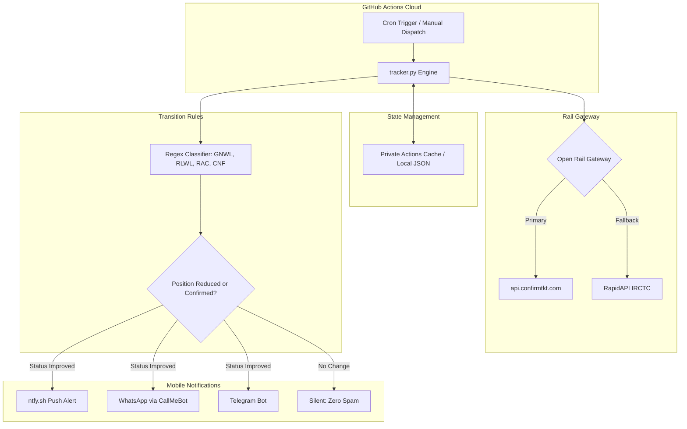

# RailPulse - Autonomous IRCTC PNR Waiting List Monitor

[](https://www.python.org/)
[](LICENSE)
[]()
[]()
[]()

> Autonomous, zero-cost cloud monitoring engine that monitors Indian Railways (IRCTC) waiting list tickets 24/7 and sends instant mobile alerts when seat status improves or confirms.

---

## The Problem and The Solution

Travelers who book Indian Railways tickets often face long waiting lists (`WL 10`, `RLWL 5`). Checking IRCTC repeatedly is tedious, commercial apps can be ad-heavy, and paid SMS services add recurring costs.

**RailPulse** addresses this problem:
* **Autonomous and Serverless**: Runs in GitHub Actions cloud for free - no dedicated server or laptop uptime required ($0/month).
* **Zero Spam Guarantee**: Completely silent background checks. It triggers an alert if and only if ticket status improves (e.g. `RLWL 10` -> `RLWL 9`, promotion to `RAC`, or final `CNF`).
* **Zero API Key Quotas**: Uses direct railway endpoint integration with RapidAPI fallback to avoid quota exhaustion.
* **Multi-Channel Instant Alerts**: Mobile notifications delivered via **ntfy.sh**, **WhatsApp**, or **Telegram**.
* **Multi-Ticket Monitoring**: Concurrently tracks multiple 10-digit PNRs in a single run.

---

## Architecture and Data Flow



---

## Notification Channels Setup Guide

RailPulse supports three delivery channels. You can use any one or all of them simultaneously.

### Channel 1: ntfy.sh (Recommended - 30 Seconds Setup)
Zero accounts, zero phone verification, zero cost.

1. Install the free **ntfy** app on your phone ([Google Play Store](https://play.google.com/store/apps/details?id=io.heckel.ntfy) or [Apple App Store](https://apps.apple.com/app/ntfy/id1625393447)).
2. Choose a unique private topic name (for example, `my-secret-train-alerts-987`).
3. Open the ntfy mobile app, tap **Subscribe to topic**, and type your topic name.
4. Set `NTFY_TOPIC=my-secret-train-alerts-987` in your `.env` or GitHub Secrets.
5. You will now receive instant push alerts with sound on your lock screen whenever your ticket status improves.

### Channel 2: WhatsApp via CallMeBot
Free WhatsApp gateway directly to your phone.

1. Add the phone number `+34 911 06 14 99` to your mobile contacts (name it "CallMeBot").
2. Open WhatsApp and send the following message to that contact:
   ```text
   I allow callmebot to send me messages
   ```
3. Within 15 to 30 seconds, the bot will reply with your personal `apikey` (for example, `123456`).
4. Set the following environment variables:
   ```ini
   WHATSAPP_PHONE=+919876543210
   CALLMEBOT_API_KEY=123456
   ```

### Channel 3: Telegram Bot
Direct alerts to your Telegram chat or channel.

1. Open Telegram and search for `@BotFather`.
2. Send `/newbot`, choose a name and username, and copy the `HTTP API Token` provided.
3. Start a chat with your newly created bot (tap Start).
4. Search for `@userinfobot` on Telegram and send `/start` to get your numeric `Chat ID`.
5. Set the following environment variables:
   ```ini
   TELEGRAM_BOT_TOKEN=123456789:ABCdefGhIJKlmNoPQRstuVWXyz
   TELEGRAM_CHAT_ID=987654321
   ```

---

## Quick Start (Local Setup)

### 1. Clone and Install
```bash
git clone https://github.com/imshivanshutiwari/irctc-pnr-notifier.git
cd irctc-pnr-notifier
pip install -r requirements.txt
```

### 2. Configure Environment
Copy the example template:
```bash
cp .env.example .env
```
Edit `.env` and fill in your details:
```ini
# One or multiple comma-separated 10-digit PNRs
PNR_NUMBER=4763331979,7000126327,6610459110

# Configure at least one notification channel:
NTFY_TOPIC=my-secret-train-alerts-987

# Optional: WhatsApp / Telegram
WHATSAPP_PHONE=
CALLMEBOT_API_KEY=
TELEGRAM_BOT_TOKEN=
TELEGRAM_CHAT_ID=
```

### 3. Run Check
```bash
python tracker.py
```

### 4. Run Automated Test Suite
```bash
python -m unittest discover -s tests -v
python -m unittest test_tracker.py -v
```
All automated unit tests run against offline mocks with zero external API calls.

---

## 24/7 Cloud Automation (GitHub Actions)

Run 24/7 background checks in the cloud for free without keeping your computer powered on:

1. **Fork or Push** this repository to your GitHub account.
2. In your repository, navigate to **Settings** -> **Secrets and variables** -> **Actions**.
3. Add the following repository secrets:
   * `PNR_NUMBER`: Your 10-digit PNR numbers (comma-separated if multiple).
   * `NTFY_TOPIC`: Your private ntfy channel topic.
   * *(Optional)* `WHATSAPP_PHONE`, `CALLMEBOT_API_KEY`, `TELEGRAM_BOT_TOKEN`, `TELEGRAM_CHAT_ID`, `RAPIDAPI_KEY`.
4. Navigate to the **Actions** tab in your repository and enable workflows.

The cloud worker wakes up every 5 hours via cron, inspects the tickets, delivers notifications upon status improvement, and securely caches state between runs without leaking passenger details into git history.

---

## Frequently Asked Questions (FAQ)

### Will other users use my API keys or phone number if they fork this repository?
**No.** This project uses a self-hosted architecture ("Bring Your Own Credentials"):
* When someone forks or clones your repository, GitHub Secrets are **not inherited**.
* Their workflow runs inside their own GitHub account using their own secrets and their own `.env` configuration.
* Your phone number, PNRs, and credentials remain private to your own repository.

### Does fetching PNR status cost money or require paid API subscriptions?
**No.** RailPulse connects directly to open railway endpoints (`api.confirmtkt.com`) which require no API keys, no subscriptions, and have no monthly call quotas. An optional RapidAPI fallback is also supported.

### Are my PNR numbers or travel details committed publicly to Git?
**No.** Runtime state is excluded in `.gitignore` and cached using GitHub Actions private caching. Passenger names are never collected or stored.

---

## Live Web Dashboard Preview

Launch the dark-mode web monitoring dashboard locally:

```bash
pip install fastapi uvicorn
python web_dashboard.py
```
Open `http://localhost:8000` in your browser to view real-time ticket statuses, coach allocations, and diff history.

---

## Project Structure

```
├── .github/workflows/
│   └── pnr_monitor.yml       # 24/7 GitHub Actions cron scheduler & CI
├── docs/                     # Software specification suite
│   ├── ARCHITECTURE.md       # High-level architecture and boundaries
│   ├── PRD.md                # Product requirements & problem statement
│   ├── DESIGN.md             # Component contracts & data flow
│   ├── SECURITY.md           # Threat modeling & secret management
│   └── TEST_PLAN.md          # Test strategy & mock verification
├── tests/
│   └── test_status_rules.py  # Deterministic regex status unit tests
├── pnr_client.py             # Dual-gateway rail API client
├── notifier.py               # Multi-channel notification adapter
├── tracker.py                # Core diff engine & atomic state manager
├── web_dashboard.py          # FastAPI + Tailwind local monitoring UI
├── test_tracker.py           # Integration & multi-passenger test suite
└── requirements.txt          # Python dependencies
```

---

## Security and Privacy

* **Zero Public Leakage**: State caches and runtime JSON are untracked in `.gitignore` to prevent travel details from being logged in git commits.
* **Secret Protection**: API tokens and phone numbers are managed through environment variables and GitHub Secrets.

---

## License

Distributed under the **MIT License**. See `LICENSE` for details.
